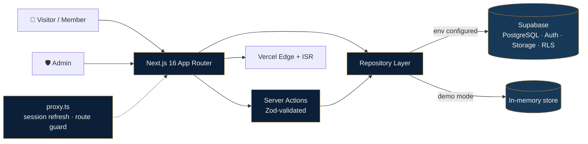

<div align="center">


<a href="https://git.io/typing-svg">
  
</a>

<br/>

[](https://nextjs.org)
[](https://react.dev)
[](https://www.typescriptlang.org)
[](https://tailwindcss.com)
[](https://supabase.com)
[](https://vercel.com)

[](#)
[](#license)
[](#seo-accessibility--performance)
[](CONTRIBUTING.md)

**[Live Site](#)** · **[Report Bug](../../issues)** · **[Request Feature](../../issues)**

</div>

---

<div align="center">

### ✦ Demo ✦


<sub>Replace `docs/demo.gif` with a recorded walkthrough of the join → approve → directory flow.</sub>

</div>

---

## 📑 Table of Contents

- [Overview](#-overview)
- [Features](#-features)
- [Architecture](#-architecture)
- [Tech Stack](#-tech-stack)
- [Getting Started](#-getting-started)
- [Connecting Supabase](#-connecting-supabase-production)
- [Project Structure](#-project-structure)
- [Design System](#-design-system)
- [Content Integrity](#-content-integrity)
- [Security & Privacy](#-security--privacy)
- [SEO, Accessibility & Performance](#-seo-accessibility--performance)
- [Deployment](#-deployment)
- [Roadmap](#-roadmap)
- [Contributing](#-contributing)
- [License](#license)

---

## 🏛️ Overview

**Newton House Alumni Association** is the official digital home of the Newton House community at
Patna Science College. It is a production-ready **Next.js 16** platform that brings together:

| | |
|:--|:--|
| 🎓 **Verified alumni network** | Searchable directory with privacy-aware visibility controls |
| 📸 **Memories archive** | Open gallery, lightbox and a memories reel |
| 📅 **Events & reunions** | Sign-ups, filters and a downloadable `.ics` calendar |
| 🏆 **Achievements** | Celebrating the brotherhood's accomplishments |
| 🔐 **Member portal** | Profile management and avatar uploads |
| 🛠️ **Admin dashboard** | Approvals, content, newsletter, messages and CSV exports |

---

## ✨ Features

<details open>
<summary><b>🌐 Public site</b></summary>

- Animated homepage with scroll-driven sections (A–J)
- Heritage pages: **About**, **Legacy** (GSAP-powered timeline)
- Alumni directory with filters and individual profile pages
- Achievements with detail pages
- Events listing, detail pages and `.ics` calendar export
- Join, contact and newsletter forms with inline validation

</details>

<details>
<summary><b>🔐 Member portal</b></summary>

- Email-link sign-up and login through Supabase Auth (PKCE)
- Profile editing with visibility control (`public` · `members` · `private`)
- Avatar upload, normalised and metadata-stripped server-side
- Password change flow

</details>

<details>
<summary><b>🧭 Admin dashboard</b></summary>

- Overview of pending and recent activity
- Alumni approval workflow (approve / reject)
- Events, achievements, gallery and announcements management
- Newsletter subscribers and contact message inbox
- One-click CSV exports with formula-injection protection

</details>

<details>
<summary><b>🧪 Demo mode</b></summary>

- Runs with **zero configuration**: no credentials required
- All flows functional against in-memory sample data
- Sample records are clearly badged, `noindex`, and excluded from the sitemap

</details>

---

## 🧩 Architecture



The **repository layer** is the key design decision: the same interfaces serve Supabase in production and an
in-memory store in demo mode, so the entire application can be developed and reviewed without infrastructure.

---

## 🛠️ Tech Stack

| Layer | Technology |
|:--|:--|
| **Framework** | Next.js 16 · App Router · React 19 · Server Actions · Turbopack · TypeScript |
| **Styling** | Tailwind CSS v4 with design tokens in `src/styles/globals.css` |
| **UI primitives** | shadcn/ui-pattern components (CVA + `tailwind-merge`) · Lucide icons |
| **Motion** | Motion for React (reveals, hero, gallery, transitions) · GSAP ScrollTrigger (timeline) |
| **Backend** | Supabase: PostgreSQL, Auth, Storage, Row Level Security |
| **Validation** | Zod, shared between forms and server actions |
| **Media** | `next/image` (AVIF/WebP) · `sharp` for EXIF/GPS stripping |
| **Hosting** | Vercel |

---

## 🚀 Getting Started

### Prerequisites


### Installation

```bash
git clone https://github.com/<your-org>/newton-house.git
cd newton-house
npm install
npm run dev            # → http://localhost:3000
```

| Script | Purpose |
|:--|:--|
| `npm run dev` | Start the development server |
| `npm run build && npm start` | Production build and serve |
| `npm run lint` | ESLint |
| `npm run typecheck` | TypeScript validation |

### 🧪 Demo mode (no credentials needed)

Without Supabase environment variables the site runs in **demo mode**:

> `/portal` and `/admin` open as a demonstration admin so the full workflow can be tested end to end:
> **register at `/join` → approve at `/admin/alumni` → see the profile in `/alumni`.**

Data resets on restart, which keeps demos clean and reproducible.

---

## ☁️ Connecting Supabase (Production)

<details>
<summary><b>Step-by-step setup</b></summary>

**1. Configure environment**

Copy `.env.example` to `.env.local` and fill in:

```env
NEXT_PUBLIC_SITE_URL=https://your-domain.com
NEXT_PUBLIC_SUPABASE_URL=https://xxxx.supabase.co
NEXT_PUBLIC_SUPABASE_ANON_KEY=your-anon-key
SUPABASE_SERVICE_ROLE_KEY=your-service-role-key   # server-only, never expose
```

**2. Apply the schema**

```bash
supabase db push
# or paste supabase/migrations/20261124000000_init.sql into the SQL editor
# optional: run supabase/seed.sql for clearly labelled sample content
```

**3. Configure Auth**

- Set **Site URL** to your domain
- Add `https://<your-domain>/auth/callback` to **Redirect URLs**
- Keep **Confirm email** enabled

**4. Grant admin rights** (after signing up once via `/join`)

```sql
insert into public.admin_users (user_id, role)
select id, 'admin' from auth.users where email = 'you@example.com';
```

**5. Restart.** Repository functions switch from memory to PostgreSQL automatically.

</details>

---

## 📂 Project Structure

<details>
<summary><b>Expand tree</b></summary>

```text
src/
├── app/
│   ├── (site)/            # public site · navbar/footer · page transitions
│   │   ├── page.tsx       # homepage (sections A–J)
│   │   ├── about/ legacy/ alumni/ achievements/ memories/
│   │   ├── events/ join/ contact/ login/ portal/
│   ├── admin/             # protected dashboard
│   ├── actions/           # server actions: public · auth · admin
│   ├── auth/callback/     # Supabase email-link handler (PKCE + token-hash)
│   └── sitemap.ts · robots.ts · manifest.ts · opengraph-image.tsx
├── components/            # animations · navigation · hero · sections · forms · admin · ui
├── data/                  # site config, image registry, clearly flagged sample content
├── lib/
│   ├── supabase/          # browser · server · public · service-role clients
│   ├── data/              # repository layer (Supabase ⇄ memory)
│   └── validations/       # Zod schemas
└── proxy.ts               # Next 16 proxy: session refresh + route guard
supabase/
├── migrations/            # schema · triggers · RLS · storage buckets & policies
└── seed.sql
```

</details>

---

## 🎨 Design System

> **Midnight Navy × Warm Ivory × Champagne Gold**
> Tokens are defined once in `src/styles/globals.css` under `@theme`.

| Token | Hex | Role |
|:--|:--:|:--|
|  | `#0B1F38` | Hero, stats, memories, footer |
|  | `#F5F1E9` | Legacy, directory, events |
|  | `#D6AD68` | Accents, CTAs, eyebrows |
|  | `#A94F38` | Architectural accent |
|  | `#14263D` | Body text |

**Typography:** Cormorant Garamond (headings) · Manrope (body & navigation) · Inter (tracked labels)
— self-hosted via `next/font/local` with size-adjusted fallbacks for **zero layout shift**.

**AA-contrast variants** (`gold-deep`, `muted-strong`) are used for small text on ivory backgrounds.

---

## 🧾 Content Integrity

The project follows a strict **no-invention** policy. Nothing is published unless it is verified.

| Content | Behaviour until verified |
|:--|:--|
| Impact statistics | Render *"Figure being verified"*; animate automatically once a number is set |
| Timeline dates | Show *"archive verification pending"*; publish with `dateLabel` + `verified: true` |
| Sample alumni, events, achievements | Badged **Sample** / **Demonstration** |
| Contact email & social links | Hidden unless set in `siteConfig`, so no link leads nowhere |
| Committee members | Not listed until confirmed |

---

## 🔒 Security & Privacy

- **Row Level Security** on every table
- The `alumni` table is **never publicly readable**. The public directory is served through the
  `alumni_directory` view, which exposes only safe columns of *approved* members
- Visibility enforced at the database level: `public` · `members` · `private`; email shown only with `show_email`
- A trigger prevents members from modifying their own moderation status
- Sign-ups create a **pending** record that an admin must approve
- Storage policies: members write only to `avatars/<their-user-id>/`; gallery and event buckets are admin-only
- Service-role key is used **server-side only**
- Uploads are validated (type, 3 MB), re-encoded to WebP, and stripped of EXIF/GPS metadata
- Honeypot fields on public forms · CSV exports guard against formula injection · security headers in `next.config.ts`

---

## ♿ SEO, Accessibility & Performance

<table>
<tr>
<td width="33%" valign="top">

**🔍 SEO**
- Per-page metadata & canonical URLs
- Open Graph / Twitter cards
- Generated OG image
- `sitemap.xml` · `robots.txt` · manifest
- JSON-LD: Organization, BreadcrumbList, Event, Person

</td>
<td width="33%" valign="top">

**♿ Accessibility**
- Semantic landmarks & skip link
- Visible focus rings
- `aria-describedby` error messaging
- Keyboard-operable menus, lightbox & reel
- Honours `prefers-reduced-motion` in CSS, Motion and GSAP

</td>
<td width="33%" valign="top">

**⚡ Performance**
- Static generation + ISR (5-min revalidation)
- On-demand revalidation after edits
- AVIF / WebP via `next/image`
- Lazy-loaded imagery
- LazyMotion feature bundle

</td>
</tr>
</table>

---

## 🌍 Deployment

1. Push to a Git repository and import it into **Vercel**
2. Add the variables from `.env.example` to **Production** and **Preview**
3. Deploy, then update Supabase Auth **Site URL** and **redirect URL** to the production domain

---

## 🗺️ Roadmap

- [x] Public site with animated homepage
- [x] Member portal and admin approval workflow
- [x] Demo mode with zero-config setup
- [ ] Replace sample content with verified alumni records
- [ ] Event payments and reunion registration
- [ ] Email notifications for approvals and events
- [ ] Multilingual interface (English / Hindi)

---

## 🤝 Contributing

Contributions that respect the design system and content-integrity policy are welcome.

```bash
git checkout -b feature/your-feature
npm run lint && npm run typecheck
git commit -m "feat: describe your change"
git push origin feature/your-feature
```

Then open a Pull Request. Please keep changes focused and include screenshots for UI work.

---

## 📜 License

Copyright © Newton House Alumni Association · Patna Science College.
All rights reserved. Contact the association before reusing any content or imagery.

---

<div align="center">


**Bound by Memories. United by Legacy.**

<sub>Built with care for the Newton House brotherhood.</sub>

</div>
